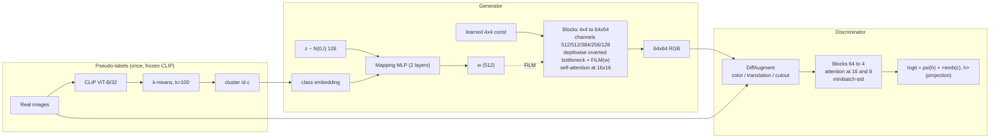
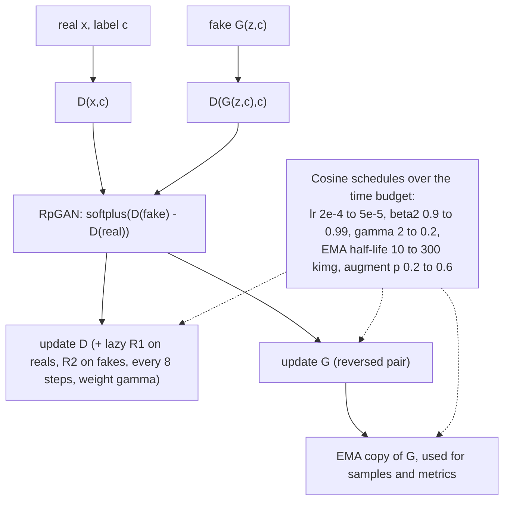

# Task 1: a modern 64x64 GAN with minimal mode collapse

**Goal.** This task trains an image GAN from scratch on the Genshin fan-art set (45,935 images, 9 characters, strongly imbalanced) at 64x64. It does so without the mode collapse of the 2022 DCGAN/ProGAN attempts.

**Idea in one paragraph.** The data has no labels. CLIP ViT-B/32 embeds every image and k-means splits it into 100 pseudo-classes. The GAN is conditioned on these clusters, so the generator is asked for every cluster in proportion to the data, and a dropped mode is directly visible to the projection discriminator. The objective is R3GAN: the relativistic pairing loss plus R1 and R2 gradient penalties. It is known to remove the mode-dropping minima of the classic losses. Both networks are normalization-free stacks of depthwise inverted bottlenecks, with attention at low resolution.

## Architecture

## Optimisation

## Measurement

- FID and KID on Inception pool3 features: 10k samples during training, 50k at the end.
- Precision and recall (k=3). Recall is the direct mode-coverage number: falling recall means collapse.
- Per-cluster sample grids, so a missing or repeated cluster is visible.

## Results so far

The first full run took 3.5 h and 30k steps, reaching **FID 111.2**. The samples are recognisable, with some tendency towards collapse. About 50% of the images show two of the nine characters. Details are in `runs/task1/report.md` on Drive.
