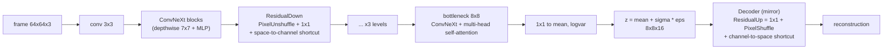
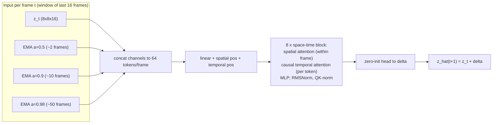
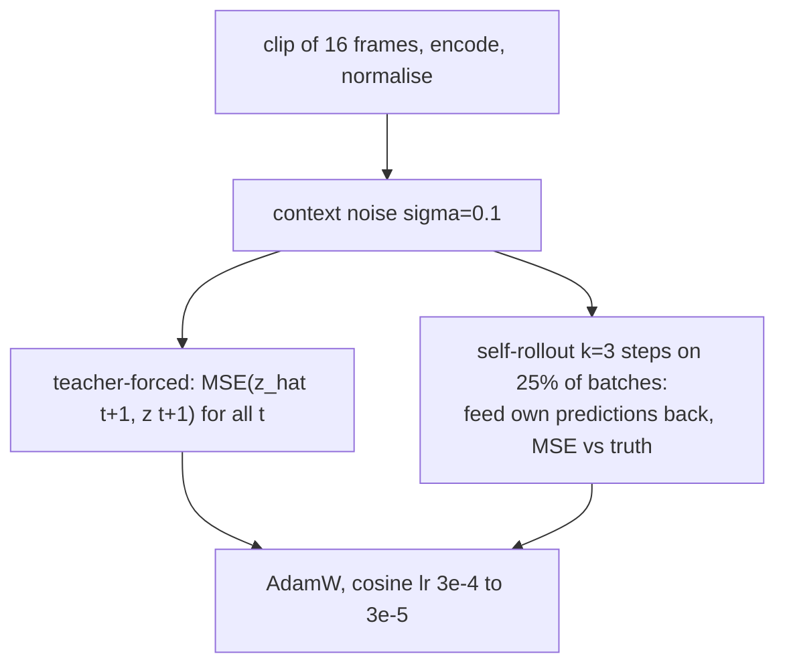

# Task 2: per-frame VAE + latent world model (next-frame prediction)

**Goal.** This task learns a compact latent space for video frames and a model that predicts the *next* latent from the past ones. Rolled out step by step and decoded, the predicted latents become a generated continuation of a video. Data: Colored Moving MNIST (synthetic, deterministic motion) first, then the Shelter music-video frames, both at 64x64.

**Idea.** This follows the author's ViVAE design. The VAE is strictly 2D and per-frame, with no temporal convolutions. All dynamics live in a separate transition model. The VAE is trained first and then **frozen**, so the world model regresses fixed targets. Plain MSE is then enough, with no anti-collapse regulariser.

## Stage 1: VAE (64x64 to 8x8x16 latent, f=8)

The loss is the sum of these terms:
- L1 + LPIPS(VGG).
- beta·KL, with warm-up.
- An EQ-VAE term: decoding a downscaled latent must give the downscaled image, which keeps the latent smooth.
- An RpGAN patch-adversarial term after 35% of the budget, with VQGAN-style adaptive weight.

After training, the per-channel latent mean and std are stored, and the world model sees normalised latents.

## Stage 2: world model (frozen VAE)

The memory has two parts:
- **Very short term:** exact attention over the last 16 latents.
- **Short to medium term:** three EMA channels, which carry information beyond the window.

The surprise-gated long-term buffer from the ViVAE notes is not implemented.

## Measurement

The VAE is scored with rPSNR, rSSIM, LPIPS and rFID. The world model is scored on held-out clips, entirely inside one shot (no scene cut), at each horizon step:
- Latent MSE.
- Decoded PSNR, SSIM and LPIPS.

Every number is compared with the **copy-last-frame baseline**: a model that has not learned motion cannot beat it. Rollouts are saved as a PNG grid and as a GIF, with real frames above the model's frames and context and generated frames marked.

## Known limitation

Rollouts degrade suddenly once they go much past the training clip length of 16 frames. The causes:
- Exposure bias: the model practises only 3 self-rollout steps in training.
- Temporal positions that were never trained.
- MSE, which averages the possible futures into blur.

Remedies to try: a rollout curriculum, relative time embeddings, a stochastic or adversarial predictor (Task 5 uses one), and the long-term memory.
