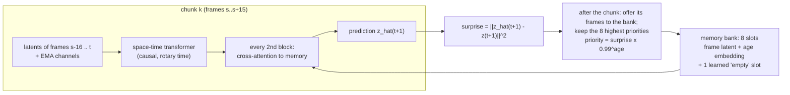

# Task 2.1: surprise-gated long-term memory (A/B experiment)

**Question.** Does the long-term memory from the ViVAE notes make the world model's long rollouts better? That memory is a buffer of past frames, chosen by how *surprising* they were (prediction error), like Prioritized Experience Replay.

**Method.** Two arms, identical except for the memory bank:
- Same frozen Task 2 VAE.
- Same data, seed and data order.
- Same time budget and hyper-parameters.

| arm | memory |
|---|---|
| `base` | Task 2 world model: the last 16–32 frames exactly (attention) + 3 EMA channels (~2/10/50 frames) |
| `ltm` | the same + **K = 8 slots** holding whole past frame latents, chosen by surprise and read by cross-attention |

Both arms use the same training setup, which differs from Task 2 as follows:
- 64-frame clips.
- Chunks of W = 16 frames.
- Rotary (relative) time positions.

Task 2 itself is therefore not one of the arms. The `base` arm is Task 2's model trained under exactly the conditions of the memory arm.

## Memory mechanism

- **Write rule.** After each chunk, its frames compete with the stored ones. The K highest priorities stay. A priority is the surprise discounted by 0.99 per frame of age, so stale frames are replaced over time. This is the PER analogy from the notes.
- **Read.** Frame tokens cross-attend to the 8×64 slot tokens. Each slot token carries its spatial position and a log-bucketed age. A learned "empty" slot is always present. The output projection starts at zero, so at initialisation `ltm` behaves exactly like `base`.
- **Generation.** A generated frame has no ground truth, so its surprise cannot be measured. It is offered with a fallback score: the latent change `||z_t − z_{t−1}||²`, rescaled by the ratio surprise/change measured on the context frames.
- **Training and generation match exactly.** A prediction at frame t attends to frames `[s−16, t]`, where s is the start of t's chunk. The bank used contains exactly the frames up to s. Unit tests check that one-step generation reproduces the teacher-forced predictions, with and without memory.

## Training

The objective is the same as in Task 2:
- Teacher-forced MSE on normalised latents, computed chunk by chunk (the bank carries no gradients, so each chunk is a separate graph).
- Context noise.
- A 3-step self-rollout loss.

## Data

| Dataset | Role |
|---|---|
| Moving MNIST (128-frame sequences) | Smoke test. Bouncing digits barely need long-term memory, so no gain is expected. |
| Shelter (main experiment) | Shots average about 21 frames (271 cuts in 5,701 frames), so 64-frame clips **cross scene cuts**, in both training and evaluation. Recalling earlier shots after a cut back is exactly where long-term memory should help. |

## Measurement

Context of 64 real frames, then 64 generated. Per horizon step, for both arms and the copy-last-frame baseline:
- PSNR, SSIM, LPIPS and latent MSE.
- Averages inside the attention span (t+1..16) and beyond it (t+17..64).

Outputs:
- `compare.md` and `compare.json`.
- `compare.png`: the curves, with a line at the window size.
- Each arm's rollout GIF.
- Bank statistics: fill, mean age, and the fraction of slots older than the window.

**Caveat.** This is one run per arm with one seed. A difference of a few tenths of a dB is within noise. A real effect should show as curves that separate beyond frame 16.
