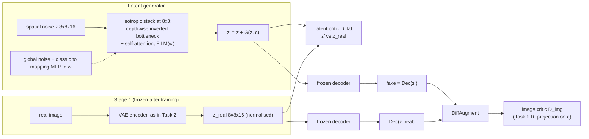
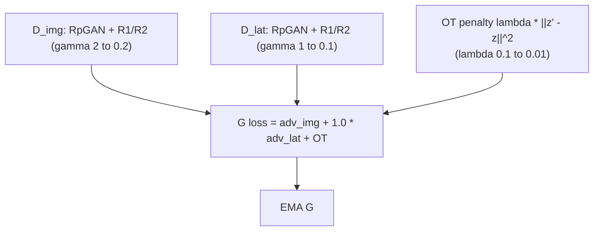

# Task 3: latent GAN, `z -> G -> z' -> Decoder -> fake image -> D`

**Goal.** This task builds a class-conditional GAN whose generator works in the latent space of a frozen VAE. The data is the same Genshin set and the same CLIP pseudo-classes as Task 1, so its numbers are directly comparable.

**Idea.** Two failure modes are typical of latent GANs, and both are designed out:
1. **The discriminator wins on VAE blur.** If D compares decoded fakes with *raw* reals, it can always spot the decoder's blur, which G cannot fix. Here the image critic compares `Dec(z')` with *decoded reals* `Dec(E(x))`.
2. **G drifts off the latent manifold.** Off-manifold latents decode to look-alike images. A second, latent critic judges `z'` against real posterior latents.

## Architecture

## Optimisation

The OT penalty biases G towards the shortest map from noise to data. Its source is Adversarial Flow Models (Lin et al.). The idea is that this makes the adversarial game better posed.

## Measurement

FID, KID, precision and recall of `Dec(G(z))` are measured against:
- the real images, which is comparable with Task 1;
- the decoded reals;
- the VAE's own rFID, the floor that any latent model inherits.
