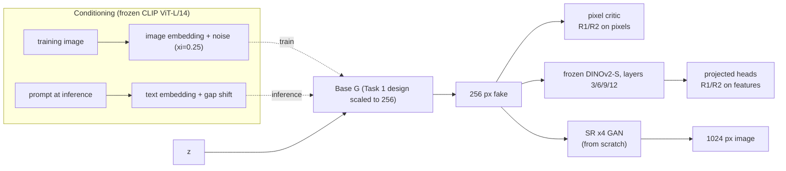
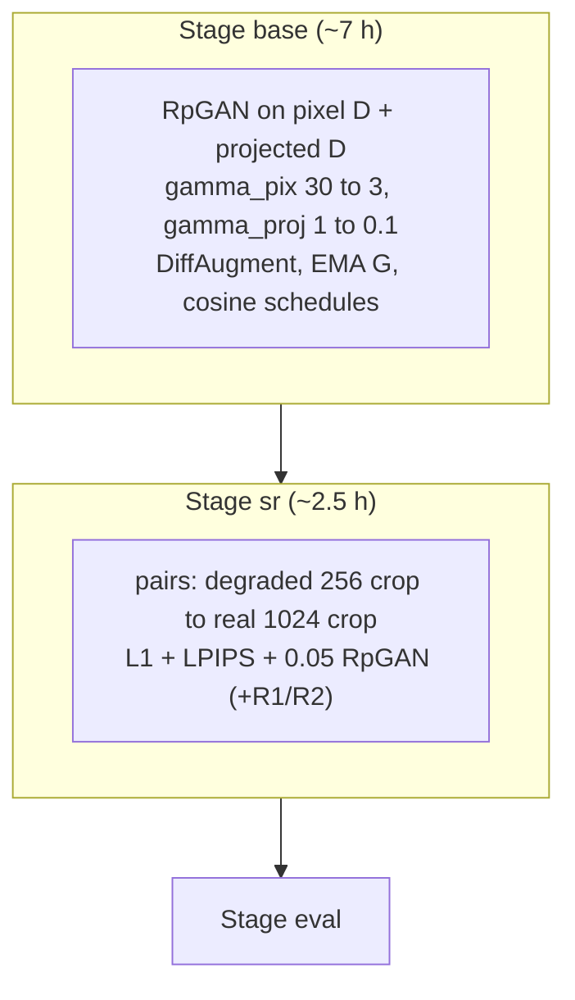

# Task 4: prompt-conditional 1024x1024 GAN in about 10 hours

**Goal.** This task generates 1024x1024 images (FFHQ faces) from text prompts after about 10 GPU-hours, trained from scratch. The only pretrained networks allowed are embedding and classification models, never generative ones.

**Idea.**
- **The base GAN at 256 px is the generative model.** A x4 super-resolution GAN, trained from scratch on real 1024 images, only adds high-frequency detail.
- **Prompting without captions** follows LAFITE. Training conditions on the CLIP *image* embedding, perturbed with noise. At inference the CLIP *text* embedding takes its place, shifted by the modality gap.
- **Fast convergence** comes from a second critic, which works on frozen DINOv2 features (Projected GAN idea). The metrics use Inception, a different network, so the critic cannot simply game the score.

## Architecture

## Optimisation

## Measurement

- FID and KID at 299 px.
- **Patch-KID** on native-resolution crops: does the 1024 detail look real?
- Precision and recall.
- CLIP score for text prompts, using CLIP B/32 (a different model from the conditioning one).
- Prompt grids and full-resolution PNGs.
