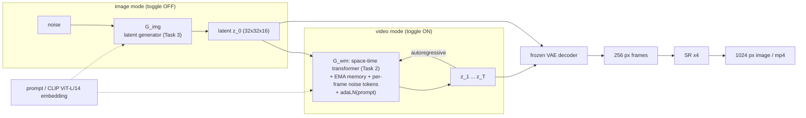
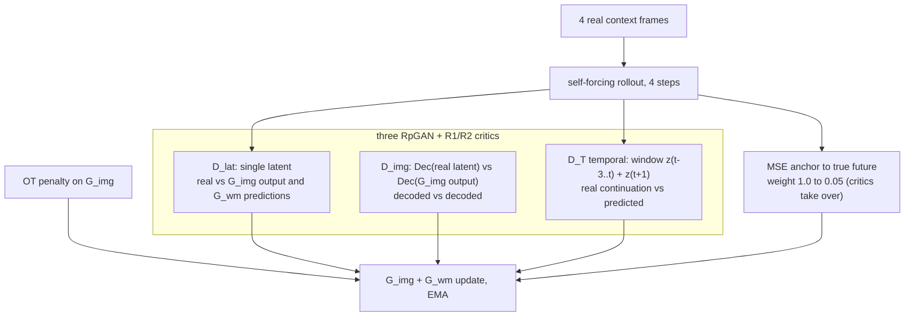

# Task 5: latent world-GAN, one model for images and videos at 1024 px

**Goal.** A single system that makes a still image with the world model OFF, or a video with the world model ON. It combines the latent GAN (Task 3), the world model (Task 2) and super-resolution (Task 4). Data: Inter4K clips at 15 fps; latents at 256 px, frames upscaled to 1024.

**Idea.** Task 2's world model is deterministic. Trained with MSE, it predicts the *average* future, which blurs and drifts. Here the world model becomes a **stochastic generator**:
- noise tokens are fed in at every frame;
- a **temporal critic** judges whether a predicted next frame is a plausible continuation;
- **self-forcing** trains it on its own rollouts, so it learns to recover from its own errors.

## Architecture

## Critics and training

Image batches and clip batches are mixed in one run, so the same generator serves both modes.

## Measurement

- Image mode: FID, KID, precision and recall at 1024 px, plus CLIP score.
- Video mode: per-horizon PSNR, SSIM and LPIPS against held-out clips, with the copy-last-frame baseline.
- mp4 and GIF videos.
